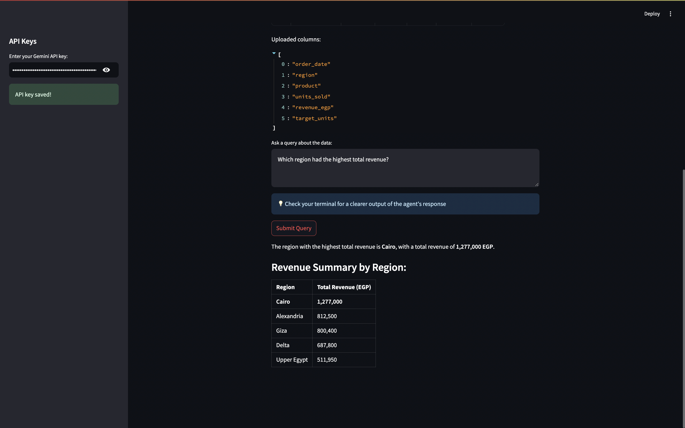

# Ask Your Data: AI Data Analyst Agent

Upload a sales spreadsheet and ask questions in plain English. The agent writes and runs SQL on your data, so answers are exact, not guessed.

## The business problem
Managers often wait for someone to pull numbers from Excel. This app lets them ask directly.

## How it works
- **Streamlit** web interface
- **Google Gemini** (free tier) as the model
- **DuckDB** to run the SQL queries the agent writes
- **pandas** to clean the uploaded file

## What I changed from the original
- Switched the model from OpenAI GPT-4o to free Google Gemini
- Fixed a NumPy/pyarrow version conflict in requirements.txt

## Results
Tested against answers calculated with pandas:
- "Which region had the highest total revenue?" → Cairo, EGP 1,277,000 ✅

## How to run
    python3 -m venv venv
    source venv/bin/activate
    pip install -r requirements.txt
    streamlit run ai_data_analyst.py

Then enter a free Gemini API key from Google AI Studio in the sidebar.

## Credits
Based on ai_data_analysis_agent from awesome-llm-apps by Shubham Saboo.